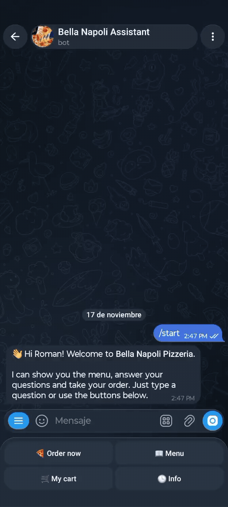
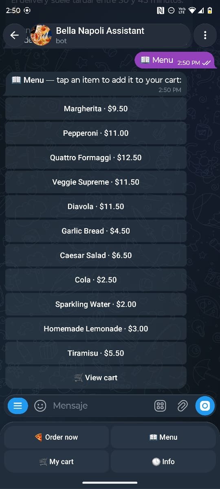
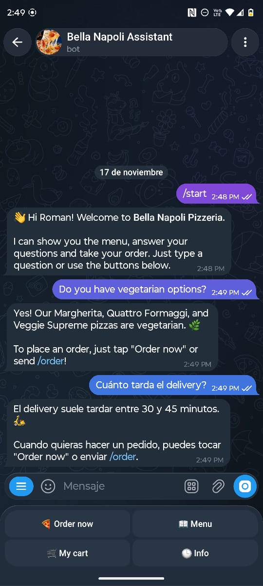
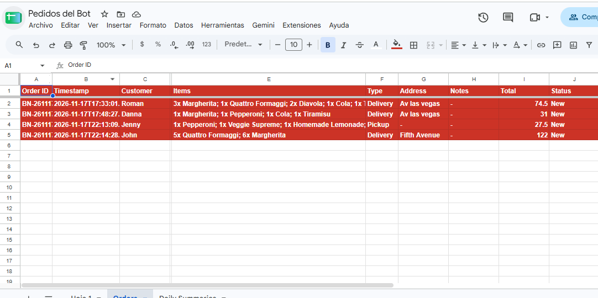
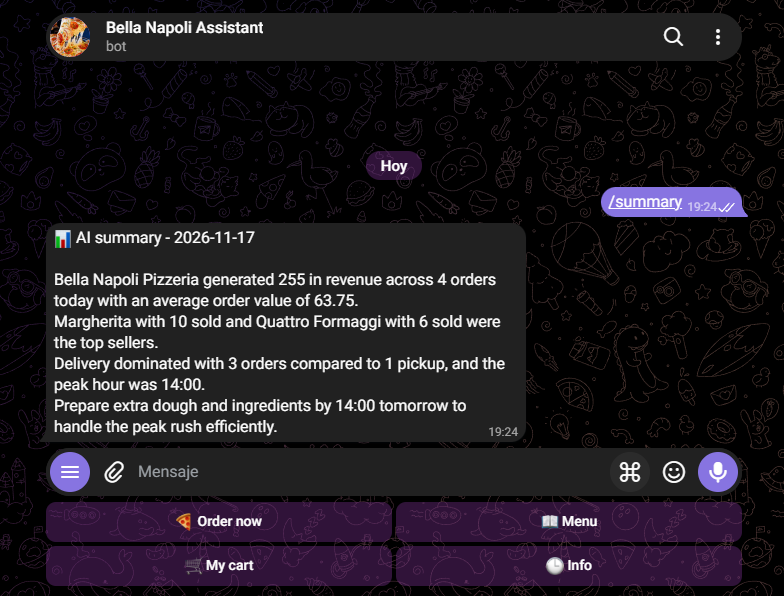
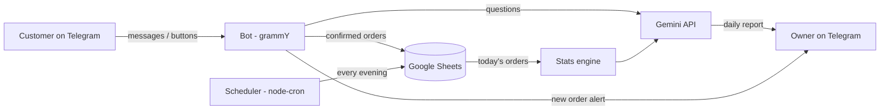

# 🍕 AI Business Assistant Bot

> A Telegram bot that answers customer questions with AI, takes orders step by step, saves everything to **Google Sheets** and sends the owner a **daily AI sales summary**.

Built with **Node.js**, **grammY**, the **Google Sheets API** and the **Gemini API**. The demo business is a pizzeria, but the bot is fully driven by one JSON file, so it can be adapted to a gym, barbershop, bakery, clinic or any small business in minutes.



## Why this exists

Small businesses lose time and sales answering the same WhatsApp/Telegram questions all day and copying orders into spreadsheets by hand. This bot automates both:

- Customers get instant answers (in their own language) at any hour.
- Orders land in a Google Sheet the owner already knows how to use, with no extra software.
- The owner receives a short report every evening instead of counting orders manually.

## Features

| | |
|---|---|
| 🤖 **AI assistant** | Answers questions about menu, hours, delivery, vegetarian options, etc. using only the business data (no invented prices). Replies in the customer's language. |
| 🛒 **Guided ordering** | Inline buttons to build a cart, choose pickup or delivery, add notes, review a summary and confirm. |
| 📊 **Google Sheets sync** | Every order is appended to an `Orders` tab. Tabs and styled headers are created automatically on first run. |
| 📈 **Daily AI summary** | A scheduled job reads the day's orders, computes stats (revenue, best sellers, peak hour) and asks the AI to write a short report for the owner. |
| 🔔 **Owner alerts** | Admins get a Telegram notification for every new order. |
| 🔐 **Admin commands** | `/admin` (live stats) and `/summary` (AI report on demand), restricted by Telegram user ID. |
| 🛡️ **Safe by design** | Rate limiting on AI calls, input length limits, HTML escaping, and Sheets writes in `RAW` mode so customer text can never run as a spreadsheet formula. |

## Screenshots

| Menu & cart | AI answering a question | Order in Google Sheets | Daily summary |
|---|---|---|---|
|  |  |  |  |

## How it works



## Tech stack

- **Node.js 20+** (ES modules, native `fetch`, built-in test runner)
- **grammY** - Telegram bot framework
- **googleapis** - Google Sheets API (service account)
- **Gemini API** - AI answers and reports (REST, no SDK)
- **node-cron** - daily scheduling with time zone support

## Quick start

```bash
git clone https://github.com/<your-user>/ai-business-assistant-bot.git
cd ai-business-assistant-bot
npm install
cp .env.example .env      # then fill in your keys
npm start
```

You need three things, all free: a Telegram bot token (from [@BotFather](https://t.me/BotFather)), a Gemini API key, and a Google service account with access to one spreadsheet. Step-by-step instructions are in **[docs/SETUP.md](docs/SETUP.md)**.

## Project structure

```
src/
├── index.js        # Telegram handlers: menu, cart, checkout, admin
├── ai.js           # Gemini integration (customer assistant + daily report)
├── sheets.js       # Google Sheets read/write and automatic tab setup
├── report.js       # Daily summary job and scheduler
├── stats.js        # Pure functions: aggregates orders into statistics
├── orders.js       # Cart and order helpers
├── business.js     # Loads and formats business data
└── data/business.json   # Menu, hours, FAQs: the only file to edit for a new business
tests/              # Unit tests for the stats engine (npm test)
docs/               # Setup guide and screenshots
```

## Adapt it to another business

1. Edit `src/data/business.json`: name, hours, menu/services, prices, FAQs.
2. Restart the bot. The AI assistant, menu buttons and reports update automatically.

## Run the tests

```bash
npm test
```

## Roadmap

- WhatsApp channel via the Cloud API
- Order status updates sent back to customers (`New → Preparing → Ready`)
- Payment links (Stripe / Mercado Pago)
- Persistent sessions with Redis for multi-instance deployments

## Need something like this for your business?

I build custom chatbots, automations, web scrapers and API integrations. Find me on [Upwork](https://www.upwork.com/) and [Fiverr](https://www.fiverr.com/pyautotech).

## License

MIT
